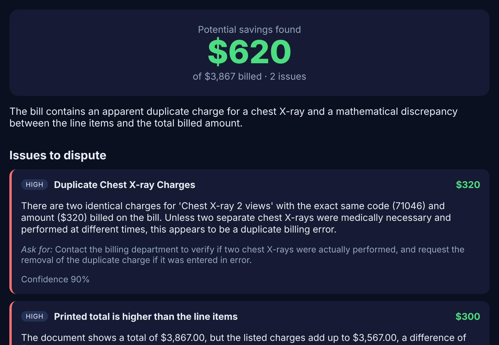
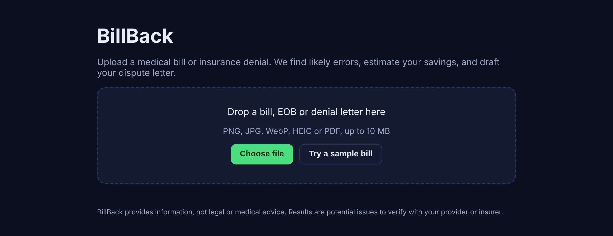
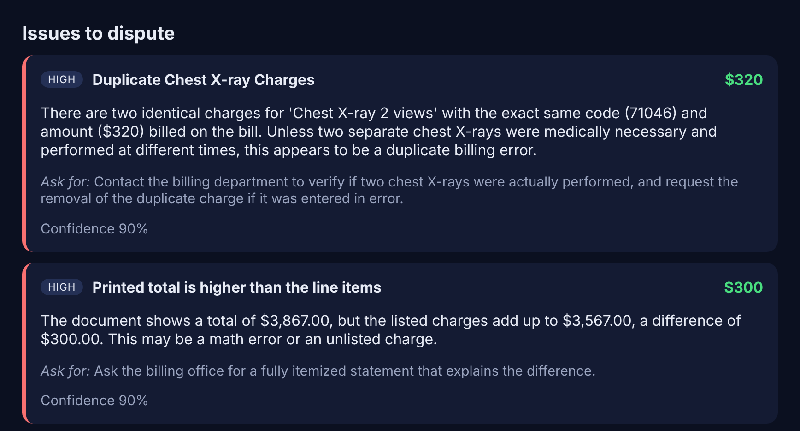
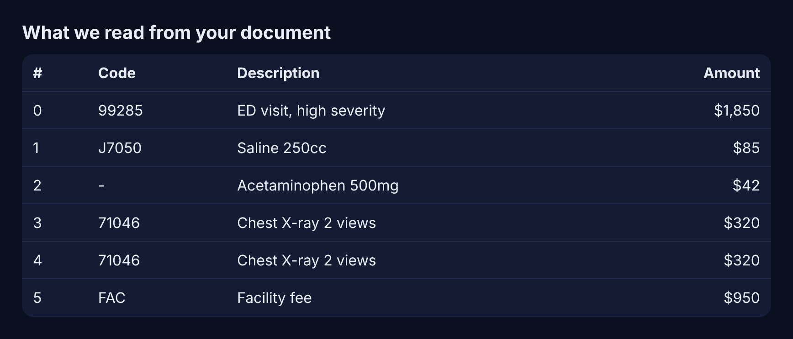
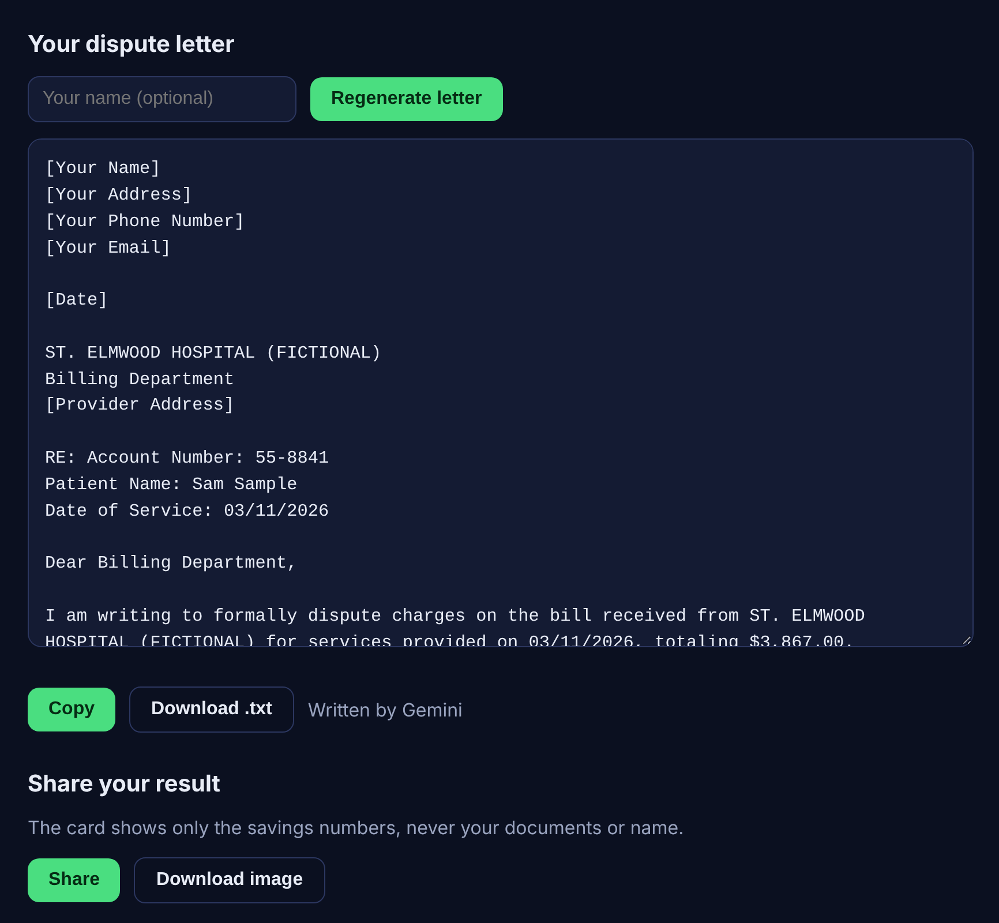
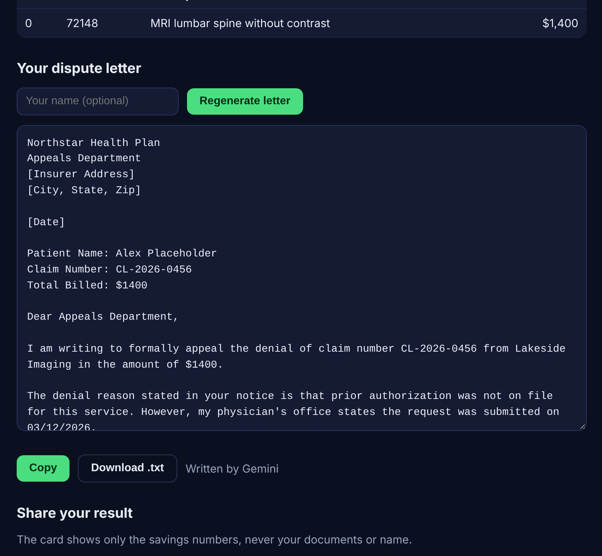
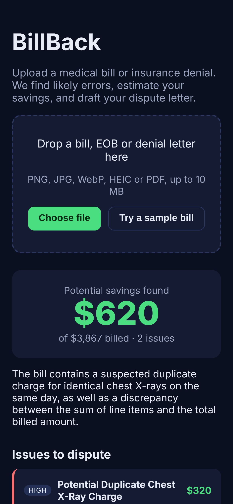
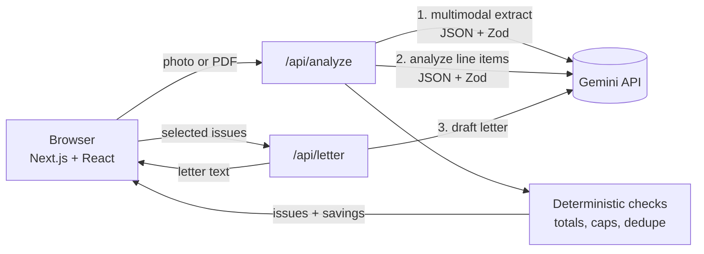

<div align="center">

# BillBack

**Find the errors in your medical bill in about 60 seconds.**

Upload a photo or PDF of a medical bill or an insurance denial. Gemini reads every line, BillBack flags potential billing errors with a dollar estimate and a confidence score, and one click drafts the dispute or appeal letter.

[**Try the live app**](https://billback-bs6g.onrender.com) · [**Pitch video (2 min)**](https://youtu.be/c704E9NkUzs) · [**Demo video (1 min)**](https://youtu.be/NHoT_VOtxrQ) · [Submission package](./submission)



<sub>Built solo for the UC Berkeley x Google DeepMind Hackathon (Google AI Studio track). All documents shown are fictional.</sub>

</div>

---

## Watch it

| 2-minute pitch | 1-minute product demo |
|---|---|
| [](https://youtu.be/c704E9NkUzs) | [](https://youtu.be/NHoT_VOtxrQ) |
| Team, problem, product and business model | The critical user journey, end to end on the live site |

## The problem

Medical bills are the only bills most people pay without understanding a single line. They arrive weeks after the care, list codes nobody outside the industry can read, and are often wrong: duplicate charges, upcoded visits, unbundled supplies, math errors, and denials that would be overturned on appeal. Hospitals and insurers have billing departments and software. The patient has a phone and a deadline.

## How it works: the user journey

### 1. Upload a bill, EOB or denial letter
Drop in a photo or a PDF (PNG, JPG, WebP, HEIC or PDF, up to 10 MB), or tap **Try a sample bill**. A crumpled phone photo works; the demo uses a deliberately blurry, rotated one.



### 2. See how much may be wrong
Gemini reads the document and extracts every line item. BillBack shows the total potential savings up front, with a one-line summary.


### 3. Review each potential issue
Every issue has a severity, a dollar estimate, a plain-English explanation, what to ask the billing office for, and a confidence score. Here: the same chest X-ray billed twice ($320), and a printed total $300 higher than the line items add up to.



### 4. Check exactly what was read
Nothing is hidden: the table shows every code, description and amount Gemini extracted, so you can verify it against your paper bill.



### 5. Draft the dispute letter in one click
Gemini writes a polite, specific letter that cites the line items and amounts, asks for an itemized statement and a collections hold, and leaves [bracketed] placeholders for anything it does not know. Copy it or download it as text.



### 6. Insurance denials become appeals
Upload a denial letter and BillBack flags it as appealable (with an honest, capped confidence) and drafts an appeal addressed to the insurer's appeals department, using only facts from the letter: claim number, denial reason, and the date the prior authorization was submitted.



### 7. Share the win, not the document
A shareable savings card shows only the numbers, never the bill or your name. The whole flow works on a phone.



## What BillBack checks

| Check | How |
|---|---|
| Duplicate charges (same code, date, amount) | Gemini analysis |
| Upcoding / unbundling suspicion | Gemini analysis |
| Charges that do not match the described service | Gemini analysis |
| Unusually high amounts | Gemini analysis |
| Appealable denial reasons (prior auth, missing info, coding errors) | Gemini analysis |
| Printed total vs. sum of line items | **Deterministic code**, never left to the model |

Guardrails keep the headline number honest: per-issue savings are capped at the amounts of the line items they reference, issues pointing at line items that do not exist are dropped, placeholder codes like `N/A` are never shown as codes, denial confidence is capped, and the total-mismatch issue is computed in code and never double counted.

## Architecture



- **Three Gemini calls:** extract (multimodal, structured JSON), analyze (structured JSON), letter (text).
- **Validated output:** every JSON response is checked with Zod; malformed output is retried once.
- **Resilient:** transient 429/5xx errors are retried with backoff, then fall back to other models.
- **Stateless and private:** files are processed in memory and never stored; document contents are never logged.
- **Self-check:** `GET /api/health` reports whether a key is configured and whether Gemini answers, without revealing the key.

## Tools used

| Tool | Used for |
|---|---|
| **Gemini API** (via **Google AI Studio**) | Multimodal reading of bill photos and PDFs, structured JSON analysis, and letter writing. Default model `gemini-flash-lite-latest` for speed (about 3 s per analysis), with automatic fallback to `gemini-3.1-flash-lite` and `gemini-flash-latest`. Set `GEMINI_MODEL` to change it. |
| **`@google/genai`** SDK | Calling Gemini from the Next.js server routes |
| **Google AI Studio** | API keys and prompt iteration |
| **Gemini TTS** | Narration for the pitch and demo videos |
| **Next.js 15, React 19, TypeScript** | App and API routes (`output: standalone`) |
| **Zod** | Schema validation of every model response |
| **Docker** + **Render** (free tier) | Hosting, deployed from a `render.yaml` Blueprint |
| **Playwright** and **ffmpeg** | End-to-end checks on the live site, README screenshots, and the demo video recording |
| **Claude Code** | Pair-programming the build, live testing and fixes |

## Run it locally

```bash
cp .env.example .env.local   # add a free key from https://aistudio.google.com/apikey
npm install
npm run dev                  # http://localhost:3000
```

No key? Click **Try a sample bill** to use the built-in fictional sample with the template letter. Never commit your key: `.env*` files are gitignored.

**Deploy:** click **New → Blueprint** on Render and select this repo; `render.yaml` sets up a free Docker web service, and you enter `GEMINI_API_KEY` in the dashboard. See [docs/DEPLOY.md](./docs/DEPLOY.md) for other options.

## Project structure

```
src/
  app/
    page.tsx              # upload, results, letter and share UI
    api/analyze/route.ts  # extract + analyze a document
    api/letter/route.ts   # draft a dispute or appeal letter
    api/health/route.ts   # deployment self-check
  lib/
    gemini.ts             # Gemini client, JSON calls, retry and model fallback
    extract.ts            # multimodal extraction prompt
    analyze.ts            # analysis prompt + deterministic checks
    schemas.ts            # Zod schemas
    letter.ts             # template letter fallback
    shareCard.ts          # savings card image
docs/samples/             # fictional test documents
submission/               # hackathon form answers, one-pagers and videos
render.yaml               # Render Blueprint
Dockerfile
```

## Business model

Free analysis. A success fee (a percentage of money recovered) or a per-letter fee, so BillBack wins only when patients win. Channels: employer benefits platforms, patient advocates, and insurers' member apps.

## Team

**Anjali Sharma-Tiwari**, solo founder. EECS + Math at Stanford. Research on deep learning for radar signals (IEEE WiSNet 2026), routing engine at DynaRyde, autonomous robotics. [LinkedIn](https://www.linkedin.com/in/anjalist)

---

> BillBack provides information, not legal or medical advice. Results are potential issues to verify with your provider or insurer. All bills shown in this README and the videos are fictional.
